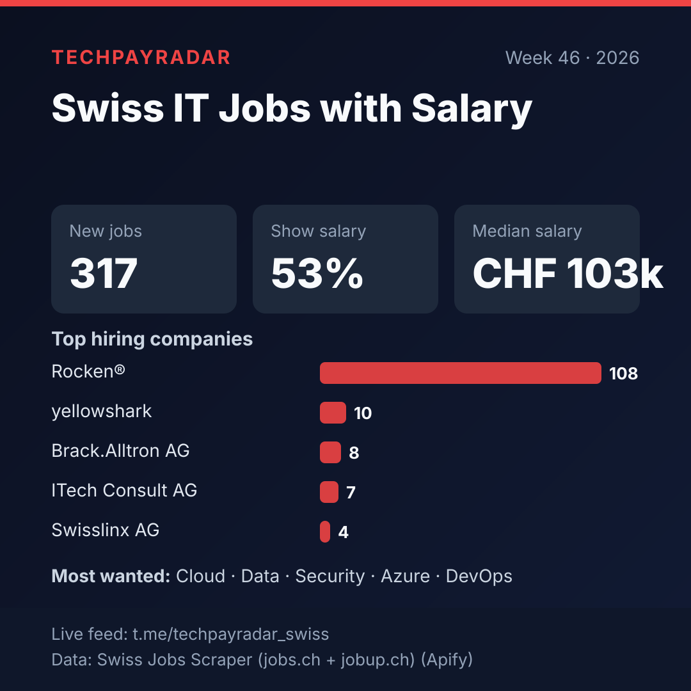
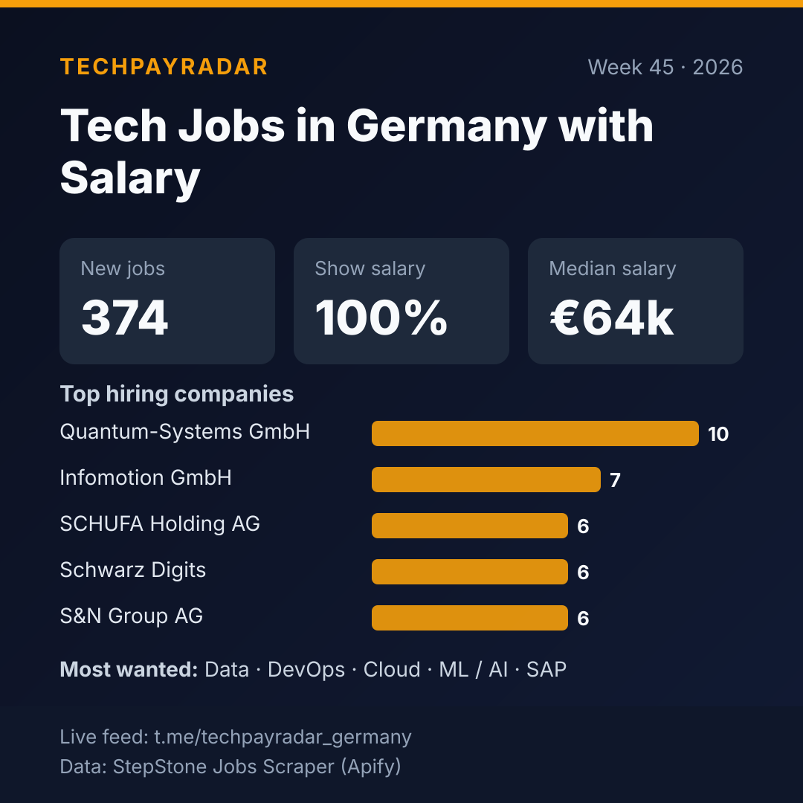

# Tech job market data, updated weekly

Weekly salary and hiring statistics for five tech job markets, computed from fresh job ads collected by TechPayRadar.
🌐 **Website with the latest jobs and every report: https://mftira.github.io/tech-job-market-data/**

Each week adds one JSON file per market in [`data/`](data/) (job count, salary coverage, median and quartiles of yearly salary, top hiring companies, most-wanted skills).

| Market | Week | New jobs | Show salary | Median yearly salary | Live job feed | Raw job data |
|---|---|---|---|---|---|---|
| US Tech Jobs with Visa Sponsorship | 2026-W46 | 341 | 35% | $130k | [Telegram](https://t.me/techpayradar_visa) | [Dice Jobs Scraper](https://apify.com/mftira/dice-jobs-scraper?utm_source=jobradar&utm_medium=github) |
| Remote Startup Jobs with Salary | 2026-W46 | 29 | 100% | $146k | [Telegram](https://t.me/techpayradar_remote) | [Wellfound Jobs Scraper](https://apify.com/mftira/wellfound-jobs-scraper?utm_source=jobradar&utm_medium=github) |
| Swiss IT Jobs with Salary | 2026-W46 | 317 | 53% | CHF 103k | [Telegram](https://t.me/techpayradar_swiss) | [Swiss Jobs Scraper (jobs.ch + jobup.ch)](https://apify.com/mftira/swiss-jobs-scraper?utm_source=jobradar&utm_medium=github) |
| Emplois tech en France avec salaire | 2026-W45 | 359 | 100% | €45k | [Telegram](https://t.me/techpayradar_france) | [HelloWork Jobs Scraper](https://apify.com/mftira/hellowork-jobs-scraper?utm_source=jobradar&utm_medium=github) |
| Tech Jobs in Germany with Salary | 2026-W45 | 374 | 100% | €64k | [Telegram](https://t.me/techpayradar_germany) | [StepStone Jobs Scraper](https://apify.com/mftira/stepstone-jobs-scraper?utm_source=jobradar&utm_medium=github) |

### US Tech Jobs with Visa Sponsorship

### Remote Startup Jobs with Salary

### Swiss IT Jobs with Salary

### Emplois tech en France avec salaire

### Tech Jobs in Germany with Salary

## Want the raw job ads?
The numbers above come from these scrapers on the Apify Store (pay per result, no subscription):
- [Dice Jobs Scraper](https://apify.com/mftira/dice-jobs-scraper?utm_source=jobradar&utm_medium=github)
- [Wellfound Jobs Scraper](https://apify.com/mftira/wellfound-jobs-scraper?utm_source=jobradar&utm_medium=github)
- [Swiss Jobs Scraper (jobs.ch + jobup.ch)](https://apify.com/mftira/swiss-jobs-scraper?utm_source=jobradar&utm_medium=github)
- [HelloWork Jobs Scraper](https://apify.com/mftira/hellowork-jobs-scraper?utm_source=jobradar&utm_medium=github)
- [StepStone Jobs Scraper](https://apify.com/mftira/stepstone-jobs-scraper?utm_source=jobradar&utm_medium=github)

_Salaries are normalised to yearly amounts in each market's main currency. Some figures are the job board's own estimates._
